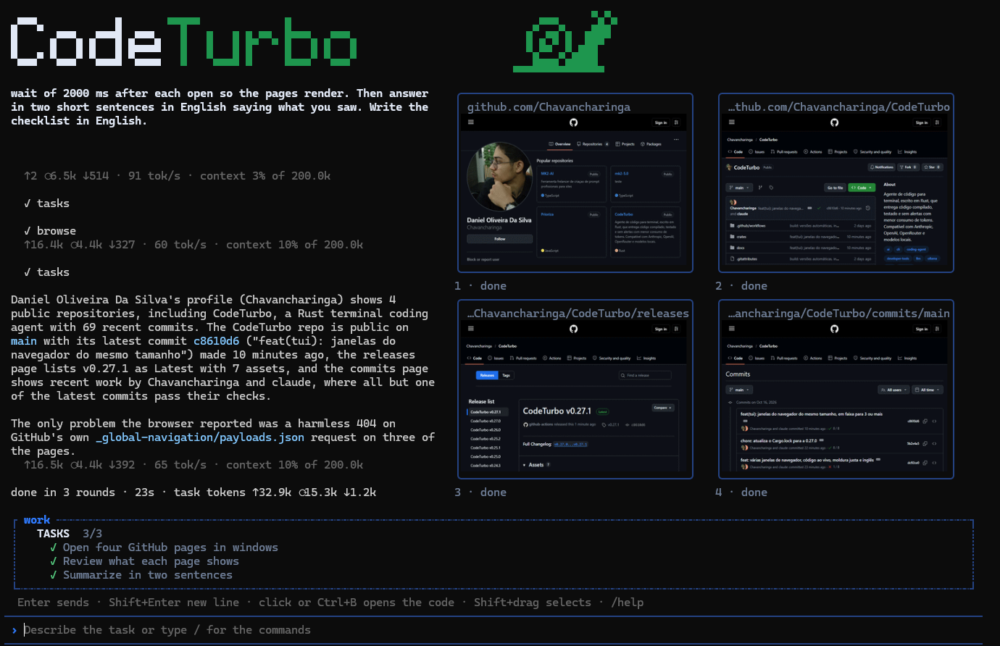
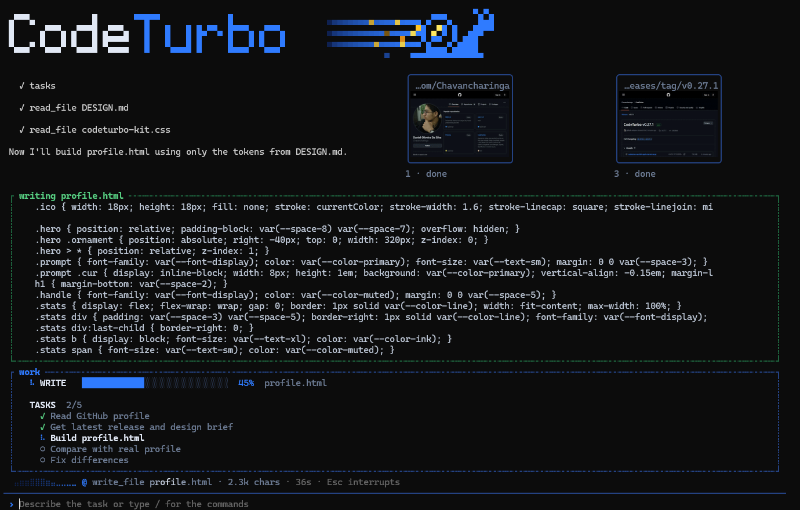

<p align="center">
  
</p>

<p align="center"><b>A terminal coding agent that ships code that builds, lints and passes its tests.</b></p>

<p align="center">
  <a href="https://github.com/Chavancharinga/CodeTurbo/releases/latest"></a>
  <a href="#license"></a>
  
  
</p>

<p align="center">
  English · <a href="README.pt-BR.md">Português</a>
</p>

---

CodeTurbo is a coding agent for the terminal, written entirely in Rust. It
works with the model you already use and adds what a model cannot do alone: a
verification gate that refuses unfinished work, a design engine, reverse
engineering tools, a real browser it can drive, and an editing path that sends
far fewer tokens per task.

```sh
codeturbo
```

<p align="center">
  
</p>

## Features

**Verified delivery**
Work is done only when the project compiles, lints clean and passes its
tests. A failing step goes back to the model for a fix, automatically. Removed
or ignored tests and silenced warnings are detected and rejected.

**Fewer tokens per task**
The agent reads and edits the exact symbol it needs instead of whole files,
analyses each change the moment it is made (Rust, JavaScript, TypeScript, CSS,
HTML, JSON, TOML) and uses provider prompt caching. Tokens, speed, context
usage, cost and rate limits stay visible the whole time.

**A browser inside the terminal**
The agent opens real pages, clicks, fills forms and tests menus while you watch
in a mini window. On terminals that draw images (Kitty, iTerm2, Sixel, Windows
Terminal) the page is a crisp picture with the agent's pointer and clicks drawn
on it; elsewhere it opens a real window beside the terminal or falls back to
blocks. To check a site with many pages, the agent opens up to six small
windows at once and drives them together.

**Design engine**
Pages and interfaces are reviewed on desktop and phone layouts against design
rules (overlaps, cut-off content, tap targets, spacing, consistency). A design
that fails is refused, with the evidence.

**Built-in reverse engineering**
The agent studies how a website, a JavaScript or Electron app, a native binary
(including x86/x64 disassembly of the relevant functions), an Android APK or a
SQLite database works, with file-and-line evidence, before building something
similar. All in Rust, with no external tools.

**Any provider, found automatically**
CodeTurbo detects what is on your machine and lists only that: the official
Claude Code, Codex and Antigravity CLIs (so your own plan is used), a running
Ollama or LM Studio, and any provider you have a key for. Anthropic, OpenAI,
Gemini, OpenRouter, Groq, DeepSeek, Mistral, xAI, Together and any
OpenAI-compatible server are supported.

**Control over every action**
Approval modes, per-tool and per-command rules, every change shown before it
is applied, and a read-only plan mode that you approve before anything is
modified. A folder must be trusted once before CodeTurbo touches it.

**One native executable**
No Node.js, no Python, no external services. Code analysis is built in;
language servers already installed on the machine are used when present.
Updates are one command.

## In action

Everything below is the real screen, recorded while the agent worked on a real
GitHub account. Nothing is a mockup.

**Several pages at once, side by side.** The agent opened a profile, a
repository, its releases and its commits together, each in its own small
browser, and read all four.

<p align="center"></p>

**The code appears as it is written.** The agent builds a page from what it just
saw, and the file grows in a box, line by line, next to the pages it is
comparing.

<p align="center"></p>

## Install

Windows (PowerShell):

```powershell
irm https://raw.githubusercontent.com/Chavancharinga/CodeTurbo/main/install.ps1 | iex
```

Linux and macOS:

```sh
curl -fsSL https://raw.githubusercontent.com/Chavancharinga/CodeTurbo/main/install.sh | sh
```

From source, with Rust 1.94 or newer:

```sh
cargo install --locked --git https://github.com/Chavancharinga/CodeTurbo coturbo-cli
```

## Quick start

Open a terminal in your project and run:

```sh
codeturbo
```

On first run CodeTurbo shows the providers it found on your machine and lets you
connect another with an API key. Nothing is preconfigured. Choices are saved
for the next sessions.

To run one task without the interface:

```sh
codeturbo run "add email validation to the signup form"
```

### Commands

| Command      | What it does                                            |
| ------------ | ------------------------------------------------------- |
| `/provider`  | choose the provider: API, local server or your own plan |
| `/model`     | choose among the provider's models                      |
| `/key`       | set the provider API key                                |
| `/approval`  | choose when CodeTurbo asks before acting                |
| `/plan`      | read-only plan mode until you approve the plan          |
| `/usage`     | tokens and cost of the session                          |
| `/undo`      | undo the changes of the last task                       |
| `/retry`     | run the last task again                                 |
| `/rule`      | pin a rule the model must always follow                 |
| `/copy`      | copy the last answer                                    |
| `/export`    | save the conversation as Markdown                       |
| `/compact`   | shrink old results and free context                     |
| `/clear`     | start a new conversation                                |
| `/update`    | install the latest version                              |
| `/help`      | list commands and shortcuts                             |
| `/exit`      | quit                                                    |

### Providers and keys

- **Your plan, no key:** choose Claude Code, Codex or Antigravity in
  `/provider`. CodeTurbo talks to the official tool already installed and signed
  in on your machine, which uses your plan as each company's terms allow, while
  the tools, the design engine and the verification stay CodeTurbo's.
- **Local models:** Ollama and LM Studio need no key and cost nothing to run.
- **Hosted models:** set a key with `/key` or with `ANTHROPIC_API_KEY`,
  `OPENAI_API_KEY`, `GEMINI_API_KEY`, `OPENROUTER_API_KEY`, `GROQ_API_KEY`,
  `DEEPSEEK_API_KEY`, `MISTRAL_API_KEY`, `XAI_API_KEY` or `TOGETHER_API_KEY`.
  Keys are stored only on your computer, outside any project.

### Project conventions

Write coding style, folders that must not change and usual commands in
`CODETURBO.md` at the project root. CodeTurbo follows it in every session and
also reads `AGENTS.md` and `CLAUDE.md` when present.

### Configuration

Preferences live in `%APPDATA%\codeturbo\config.toml` on Windows and
`~/.config/codeturbo/config.toml` on Linux and macOS.

| Variable                       | Effect                                                         |
| ------------------------------ | -------------------------------------------------------------- |
| `CODETURBO_BROWSER`            | `window` or `headless`: how the agent's browser opens          |
| `CODETURBO_GRAPHICS`           | `off` keeps the mini browser in blocks instead of an image     |
| `CODETURBO_NO_UPDATE_CHECK`    | turns the daily update notice off                              |

## Updating

CodeTurbo checks once a day for a newer release and tells you when it opens.

```sh
codeturbo update
```

## Status

Under active development. Releases and notes are on the
[releases page](https://github.com/Chavancharinga/CodeTurbo/releases).

## License

Licensed, at your option, under either of:

- Apache License, Version 2.0 ([LICENSE-APACHE](LICENSE-APACHE))
- MIT license ([LICENSE-MIT](LICENSE-MIT))

Unless you state otherwise, any contribution you submit for inclusion in the
project is licensed the same way, without any additional terms or conditions.
