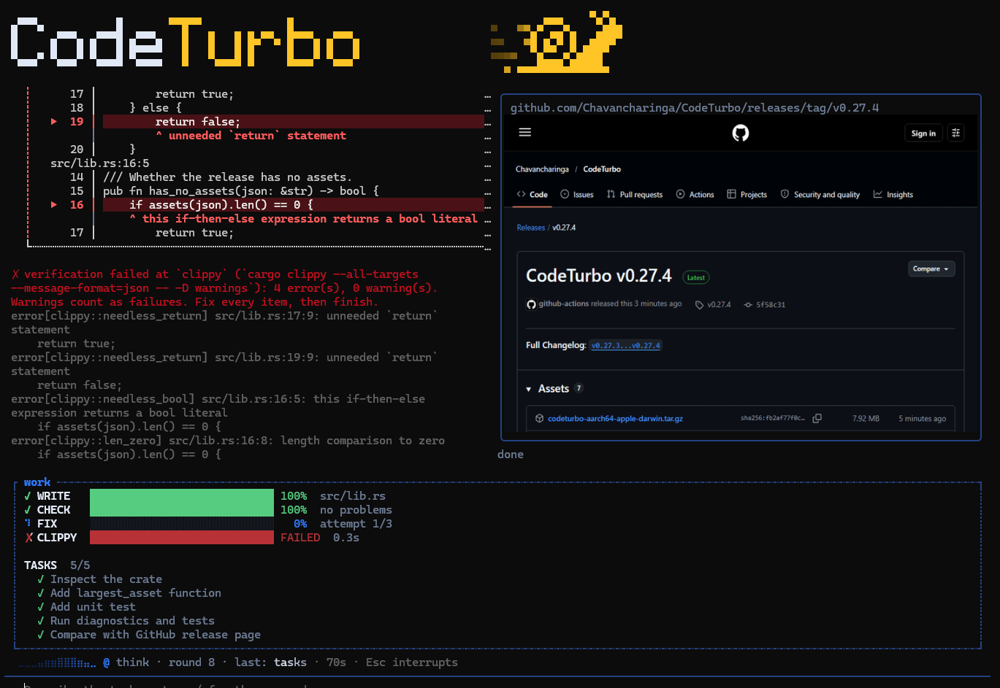
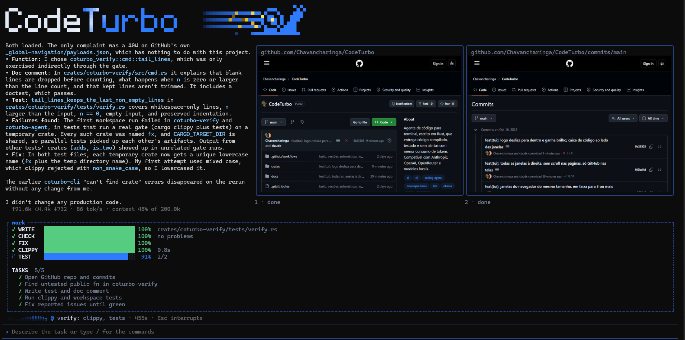
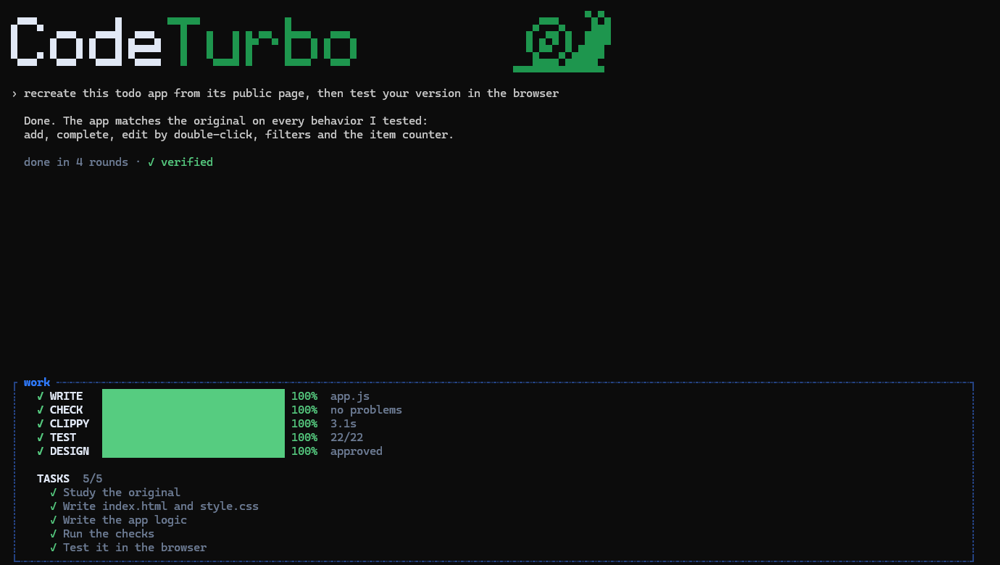

<p align="center">
  
</p>

<p align="center"><b>Um agente de código para o terminal que entrega código que compila, passa na análise e nos testes.</b></p>

<p align="center">
  <a href="https://github.com/Chavancharinga/CodeTurbo/releases/latest"></a>
  <a href="#licença"></a>
  
  
</p>

<p align="center">
  <a href="README.md">English</a> · Português
</p>

---

O CodeTurbo é um agente de código para o terminal, escrito inteiramente em
Rust. Ele trabalha com o modelo que você já usa e acrescenta o que um modelo
sozinho não faz: uma verificação que recusa trabalho inacabado, um motor de
design, ferramentas de engenharia reversa, um navegador real que ele controla e
um caminho de edição que envia muito menos tokens por tarefa.

```sh
codeturbo
```

<p align="center">
  
</p>

## Recursos

**Entrega verificada**
A tarefa só termina quando o projeto compila, passa na análise estática e
nos testes. Uma etapa que falha volta ao modelo para correção, sem
intervenção manual. Testes removidos ou ignorados e alertas silenciados são
detectados e recusados.

**Menos tokens por tarefa**
O agente lê e altera exatamente o símbolo de que precisa, em vez de arquivos
inteiros, analisa cada alteração no instante em que é feita (Rust, JavaScript,
TypeScript, CSS, HTML, JSON, TOML) e aproveita o cache de prompt dos
provedores. Tokens, velocidade, uso do contexto, custo e limites ficam sempre
visíveis.

**Navegador dentro do terminal**
O agente abre páginas reais, clica, preenche formulários e testa menus enquanto
você acompanha numa mini janela. Em terminais que desenham imagens (Kitty,
iTerm2, Sixel, Windows Terminal) a página é uma imagem nítida, com o ponteiro e
os cliques do agente desenhados; nos demais, abre uma janela real ao lado do
terminal ou usa blocos. Para verificar um site com várias páginas, o agente abre
até seis mini janelas de uma vez e as controla juntas.

**Motor de design**
Páginas e interfaces são revisadas em desktop e celular contra regras de design
(sobreposição, conteúdo cortado, alvos de toque, espaçamento, consistência). Um
design reprovado é recusado, com as evidências.

**Engenharia reversa embutida**
O agente estuda como um site, um aplicativo JavaScript ou Electron, um binário
nativo (incluindo a desmontagem x86/x64 das funções relevantes), um APK de
Android ou um banco SQLite funciona, com evidências de arquivo e linha, antes de
construir algo semelhante. Tudo em Rust, sem ferramentas externas.

**Qualquer provedor, encontrado automaticamente**
O CodeTurbo detecta o que existe na sua máquina e lista só isso: as CLIs
oficiais do Claude Code, Codex e Antigravity (usando o seu plano), um Ollama ou
LM Studio em execução e os provedores para os quais você tem chave. Anthropic,
OpenAI, Gemini, OpenRouter, Groq, DeepSeek, Mistral, xAI, Together e qualquer
servidor compatível com OpenAI.

**Controle sobre cada ação**
Modos de aprovação, regras por ferramenta e por comando, cada alteração exibida
antes de ser aplicada e um modo plano somente leitura que você aprova antes de
qualquer modificação. Uma pasta precisa ser autorizada uma vez antes de o
CodeTurbo mexer nela.

**Um único executável nativo**
Sem Node.js, Python ou serviços externos. A análise de código é embutida;
servidores de linguagem já instalados são aproveitados. Atualização com um
comando.

## Em ação

Tudo abaixo é a tela real, gravada enquanto o agente trabalhava numa conta real
do GitHub e no próprio repositório do CodeTurbo. Nada é maquete.

**O código aparece enquanto é escrito,** numa caixa ao lado das páginas que o
agente mantém abertas.

<p align="center"></p>

**Um debugger que aponta a linha exata.** Quando uma checagem falha, as linhas
com problema aparecem com a coluna e o motivo, o caracol fica amarelo e a
correção começa sozinha.

<p align="center"></p>

**A verificação a toda velocidade.** O caracol corre com tudo enquanto a análise
e os testes carregam, barra a barra.

<p align="center"></p>

**Concluído significa verificado.** O caracol só fica verde quando tudo passou.

<p align="center"></p>

## Instalação

Windows (PowerShell):

```powershell
irm https://raw.githubusercontent.com/Chavancharinga/CodeTurbo/main/install.ps1 | iex
```

Linux e macOS:

```sh
curl -fsSL https://raw.githubusercontent.com/Chavancharinga/CodeTurbo/main/install.sh | sh
```

A partir do código-fonte, com Rust 1.94 ou superior:

```sh
cargo install --locked --git https://github.com/Chavancharinga/CodeTurbo coturbo-cli
```

## Primeiros passos

Abra um terminal na pasta do projeto e execute:

```sh
codeturbo
```

Na primeira execução o CodeTurbo mostra os provedores que encontrou na sua
máquina e permite conectar outro com uma chave de API. Nada vem pré-configurado.
As escolhas ficam salvas.

Para executar uma tarefa sem a interface:

```sh
codeturbo run "adicione validação de e-mail ao formulário de cadastro"
```

### Comandos

| Comando      | Função                                                       |
| ------------ | ------------------------------------------------------------ |
| `/provider`  | escolher o provedor: API, servidor local ou o seu plano      |
| `/model`     | escolher o modelo entre os do provedor                       |
| `/key`       | informar a chave de API                                      |
| `/approval`  | definir quando pedir confirmação                             |
| `/plan`      | modo plano, somente leitura até a aprovação                  |
| `/usage`     | tokens e custo da sessão                                     |
| `/undo`      | desfazer as alterações da última tarefa                      |
| `/retry`     | refazer a última tarefa                                      |
| `/rule`      | fixar uma regra que o modelo sempre deve seguir              |
| `/copy`      | copiar a última resposta                                     |
| `/export`    | salvar a conversa em Markdown                                |
| `/compact`   | resumir resultados antigos e liberar contexto                |
| `/clear`     | iniciar uma nova conversa                                    |
| `/update`    | instalar a versão mais recente                               |
| `/help`      | listar comandos e atalhos                                    |
| `/exit`      | encerrar                                                     |

Os nomes antigos em português (`/provedor`, `/modelo`, `/chave`…) continuam
funcionando como apelidos.

### Provedores e chaves

- **O seu plano, sem chave:** escolha Claude Code, Codex ou Antigravity em
  `/provider`. O CodeTurbo conversa com a ferramenta oficial já instalada e
  logada, que usa o seu plano como os termos de cada empresa permitem, enquanto
  as ferramentas, o motor de design e a verificação continuam sendo os do
  CodeTurbo.
- **Modelos locais:** Ollama e LM Studio dispensam chave e não geram custo.
- **Modelos em nuvem:** informe a chave com `/key` ou pelas variáveis
  `ANTHROPIC_API_KEY`, `OPENAI_API_KEY`, `GEMINI_API_KEY`,
  `OPENROUTER_API_KEY`, `GROQ_API_KEY`, `DEEPSEEK_API_KEY`, `MISTRAL_API_KEY`,
  `XAI_API_KEY` ou `TOGETHER_API_KEY`. As chaves ficam só no seu computador,
  fora de qualquer projeto.

### Convenções do projeto

Escreva estilo de código, pastas que não devem mudar e comandos usuais em
`CODETURBO.md` na raiz do projeto. O CodeTurbo o segue em toda sessão e também
lê `AGENTS.md` e `CLAUDE.md`, quando existirem.

### Configuração

As preferências ficam em `%APPDATA%\codeturbo\config.toml` no Windows e em
`~/.config/codeturbo/config.toml` no Linux e no macOS.

| Variável                    | Efeito                                                       |
| --------------------------- | ------------------------------------------------------------ |
| `CODETURBO_BROWSER`         | `window` ou `headless`: como o navegador do agente abre      |
| `CODETURBO_GRAPHICS`        | `off` mantém a mini janela em blocos, sem imagem             |
| `CODETURBO_NO_UPDATE_CHECK` | desliga o aviso diário de atualização                        |

## Atualização

O CodeTurbo verifica uma vez por dia se existe uma versão mais recente e avisa
ao abrir.

```sh
codeturbo update
```

## Situação do projeto

Em desenvolvimento ativo. Versões e notas na
[página de releases](https://github.com/Chavancharinga/CodeTurbo/releases).

## Licença

Licenciado, à sua escolha, sob uma das seguintes licenças:

- Apache License, Version 2.0 ([LICENSE-APACHE](LICENSE-APACHE))
- Licença MIT ([LICENSE-MIT](LICENSE-MIT))

Salvo indicação em contrário, qualquer contribuição enviada para inclusão no
projeto fica licenciada da mesma forma, sem termos ou condições adicionais.
